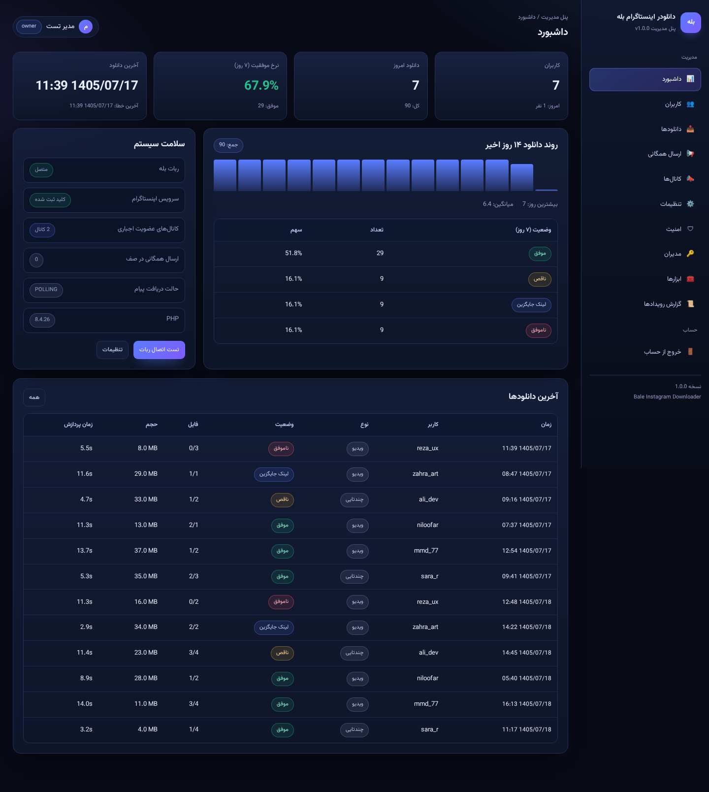
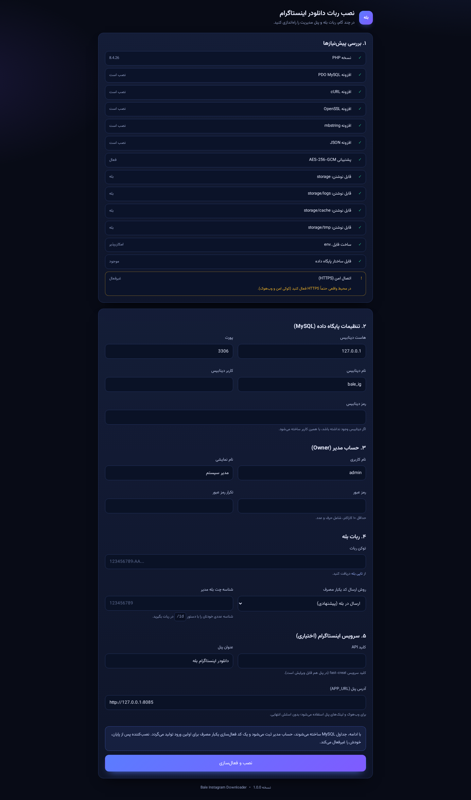
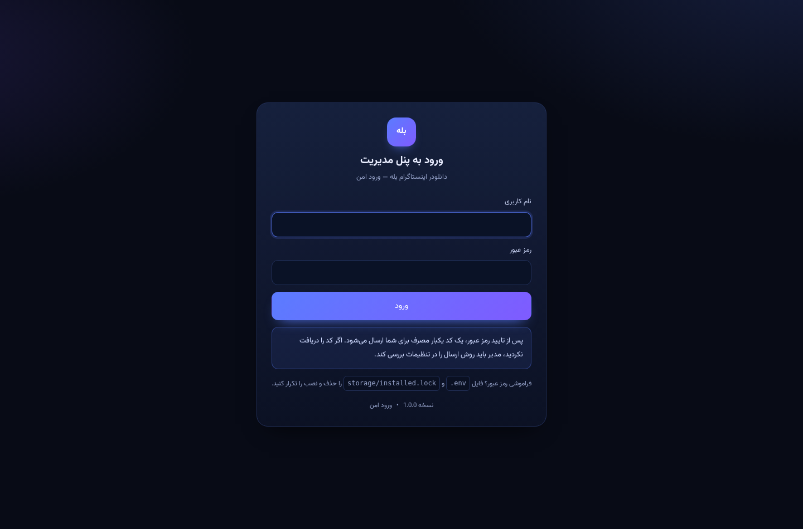
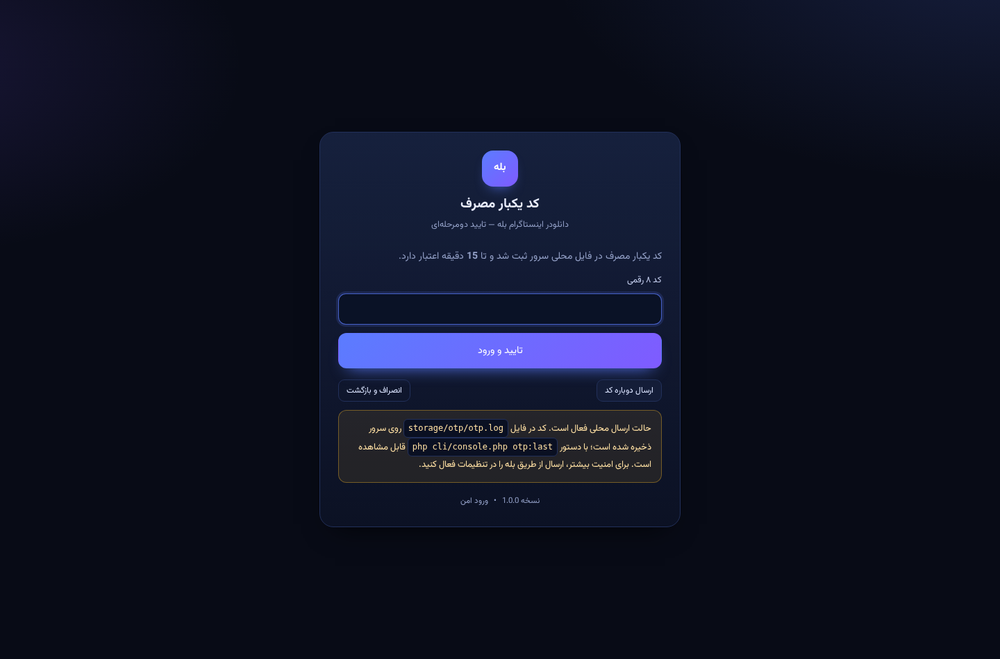
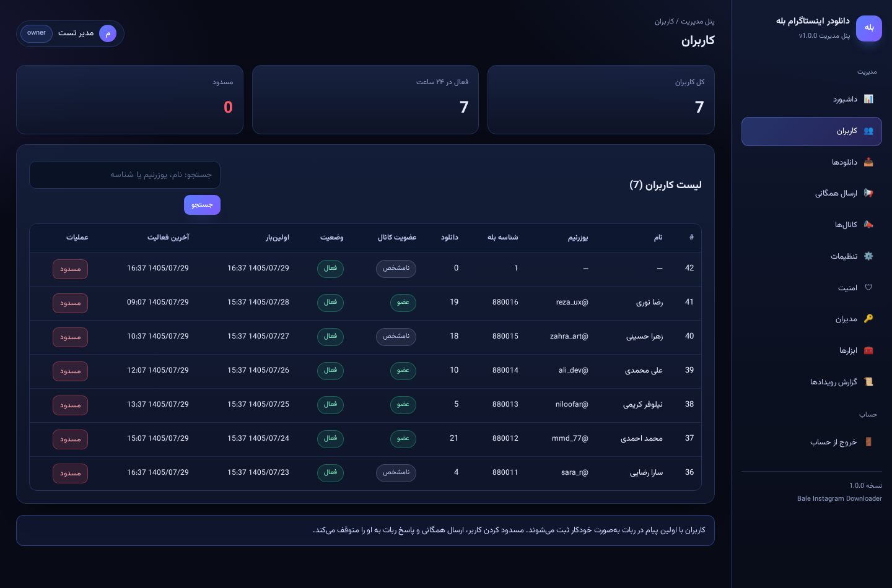
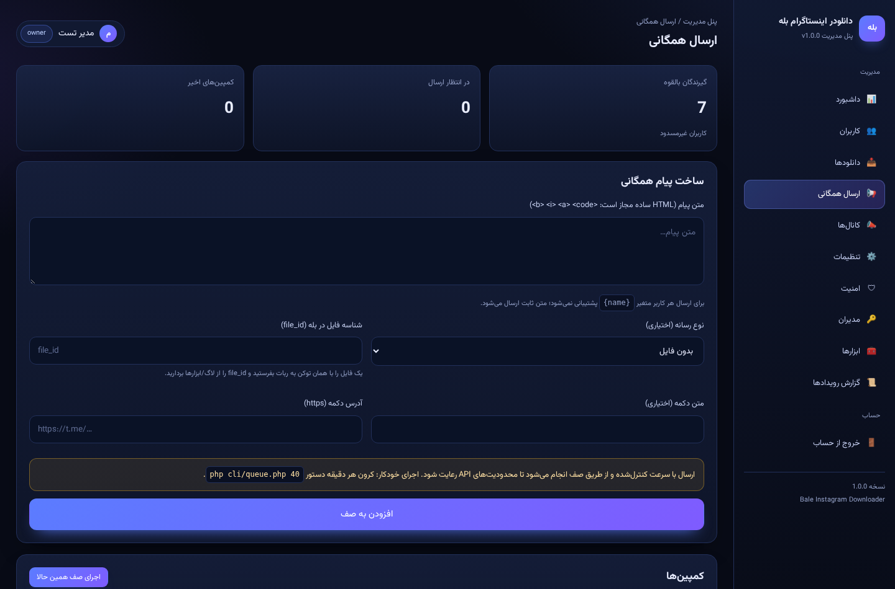
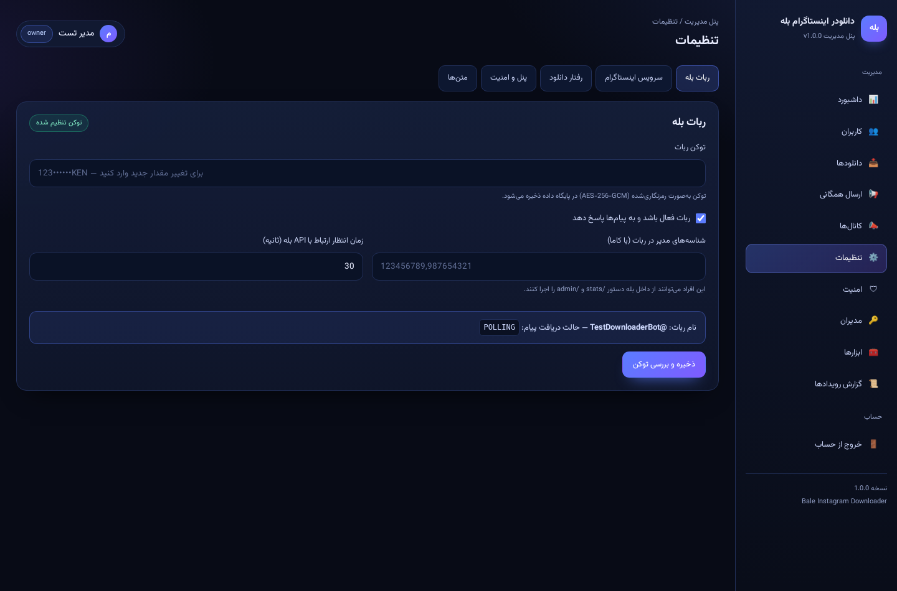
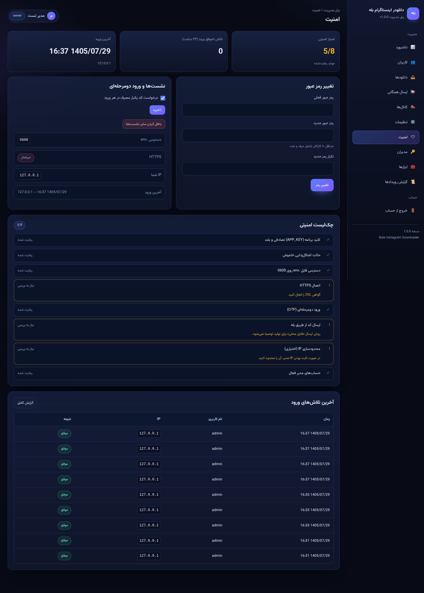
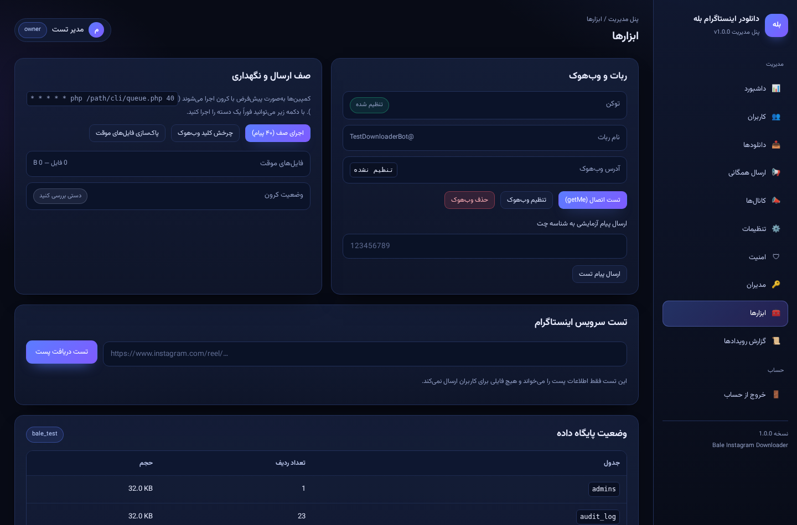

# 🤖 Bale Instagram Downloader — ربات دانلودر اینستاگرام بله

<div dir="rtl">

ربات دانلودر اینستاگرام برای پیام‌رسان **بله** + **پنل مدیریت حرفه‌ای**، نوشته‌شده با **PHP 8** و **MySQL**.
این پروژه بازنویسی کامل یک ربات پایتونی (python-telegram-bot) است که برای بله طراحی شده، مشکلات امنیتی و منطقی آن برطرف شده و یک سیستم نصب و ورود با **رمز یکبار مصرف (OTP)** دارد.

<p align="center">
  
</p>

<details>
<summary>🖼 تصاویر بیشتر از پنل و نصب‌کننده</summary>

| | |
|---|---|
|  |  |
|  |  |
|  |  |
|  |  |

</details>

| | |
|---|---|
| **زبان** | PHP 8.1+ (بدون هیچ فریم‌ورک و بدون Composer) |
| **پایگاه داده** | MySQL 5.7+ / MariaDB 10.3+ |
| **پیام‌رسان** | Bale Bot API — `https://tapi.bale.ai/bot<TOKEN>/<METHOD>` |
| **پنل** | داشبورد، کاربران، دانلودها، ارسال همگانی، کانال‌ها، تنظیمات، امنیت، مدیران، ابزارها، گزارش رویدادها |
| **نصب** | نصب‌کننده چندمرحله‌ای وب + کد فعال‌سازی یکبارمصرف |
| **تست** | ۳۰ تست یکپارچه با سرور Mock بله/اینستاگرام + ۲۹ تست دود HTTP |

---

## فهرست

- [امکانات](#امکانات)
- [پیش‌نیازها](#پیشنیازها)
- [نصب سریع](#نصب-سریع)
- [اولین ورود و رمز یکبار مصرف](#اولین-ورود-و-رمز-یکبار-مصرف)
- [تنظیم ربات بله](#تنظیم-ربات-بله)
- [دریافت پیام‌ها: polling یا webhook](#دریافت-پیامها-polling-یا-webhook)
- [کرون‌جاب‌ها](#کرونجابها)
- [تنظیمات مهم](#تنظیمات-مهم)
- [ساختار پروژه](#ساختار-پروژه)
- [امنیت](#امنیت)
- [تست‌ها](#تستها)
- [عیب‌یابی](#عیبیابی)
- [چه چیزی نسبت به نسخه پایتون بهتر شد](#چه-چیزی-نسبت-به-نسخه-پایتون-بهتر-شد)
- [مجوز](#مجوز)

---

## امکانات

### ربات

- ✅ دریافت لینک پست / ریلز / IGTV و ارسال ویدیو، صدا و تصاویر با کیفیت اصلی
- ✅ پشتیبانی از پست‌های چندتایی (کاروسل) و ارسال کاور
- ✅ **Fallback هوشمند**: اگر دانلود، حجم یا ارسال فایل ممکن نبود → ارسال لینک مستقیم
- ✅ بررسی عضویت در کانال‌های اجباری (با دکمه «✅ عضو شدم» و بازبینی زنده)
- ✅ محدودیت نرخ درخواست برای هر کاربر (پیش‌فرض ۳۰ لینک در ساعت)
- ✅ ضد تکرار (deduplication) روی `update_id` — پیام تکراری دوبار پردازش نمی‌شود
- ✅ دستورهای `/start` `/help` `/id` و `/stats` برای مدیر
- ✅ پیام‌های فارسی، امن (HTML escape) و قابل ویرایش از پنل

### پنل مدیریت

- 📊 **داشبورد**: کاربران، دانلود امروز، نرخ موفقیت، نمودار ۱۴ روزه، سلامت سیستم
- 👥 **کاربران**: جستجو، صفحه‌بندی، مسدود/رفع مسدودی
- 📥 **دانلودها**: فیلتر بر اساس وضعیت، حجم، مدت پردازش، پیام خطا، پاک‌سازی رکوردهای قدیمی
- 📢 **ارسال همگانی (Broadcast)**: صف دائمی در MySQL، پیشرفت زنده، فایل/دکمه شیشه‌ای، لغو کمپین
- 📣 **کانال‌ها**: مدیریت کانال‌های عضویت اجباری + گیت Fail-open/Fail-closed
- ⚙️ **تنظیمات**: توکن ربات (تست خودکار `getMe`)، کلیدAPI، رفتار دانلود، متن‌ها
- 🛡 **امنیت**: تغییر رمز، روشن/خاموش کردن 2FA، ابطال همه نشست‌ها، چک‌لیست امنیتی زنده
- 🔑 **مدیران**: چند مدیر با نقش `owner`/`admin`، غیرفعال‌سازی، بازنشانی رمز، رفع قفل
- 🧰 **ابزارها**: تست `getMe`، تنظیم/حذف webhook، اجرای دستی صف، تست دریافت پست، وضعیت جداول
- 📜 **گزارش رویدادها**: Audit log فقط‌افزودنی برای همه اقدامات حساس

### نصب

- 🧙 نصب‌کننده وب با بررسی پیش‌نیازها (PHP، افزونه‌ها، دسترسی پوشه‌ها، HTTPS)
- 🔐 تولید `.env` با `APP_KEY` تصادفی و دسترسی `0600`
- 🎟 کد فعال‌سازی ۸ رقمی یکبارمصرف برای اولین ورود (ارسال در بله یا فایل محلی)
- 🚫 بعد از نصب، نصب‌کننده خودش را قفل می‌کند (`storage/installed.lock`)

---

## پیش‌نیازها

| مورد | حداقل |
|---|---|
| PHP | 8.1 (تست‌شده روی 8.4) |
| افزونه‌های PHP | `pdo_mysql` `curl` `openssl` `mbstring` `json` |
| پایگاه داده | MySQL 5.7+ یا MariaDB 10.3+ |
| وب‌سرور | Apache با `mod_rewrite` یا Nginx |
| SSL | برای محیط واقعی الزامی (webhook و کوکی امن) |
| اختیاری | `php-cli` برای polling و کرون |

> پروژه هیچ وابستگی خارجی (Composer/npm) ندارد؛ کل کد خوانا و قابل بازبینی است.

---

## نصب سریع

### ۱) آپلود پروژه

```bash
git clone https://github.com/USERNAME/bale-instagram-downloader.git
cd bale-instagram-downloader
# DocumentRoot را روی پوشه public/ تنظیم کنید
```

### ۲) دسترسی‌ها

```bash
chmod -R 770 storage
chmod 600 .env.example
```

### ۳) ساخت پایگاه داده (اختیاری — نصب‌کننده خودش می‌سازد)

```sql
CREATE DATABASE bale_ig CHARACTER SET utf8mb4 COLLATE utf8mb4_unicode_ci;
CREATE USER 'bale_ig'@'localhost' IDENTIFIED BY 'STRONG_PASSWORD';
GRANT ALL PRIVILEGES ON bale_ig.* TO 'bale_ig'@'localhost';
```

### ۴) اجرای نصب‌کننده

مرورگر را روی `https://your-domain/install.php` باز کنید و فرم را پر کنید:

1. بررسی پیش‌نیازها (قرمزها باید رفع شوند)
2. اطلاعات MySQL
3. حساب مدیر (نام کاربری + رمز قوی)
4. توکن ربات بله + شناسه چت خودتان برای دریافت کد
5. کلید API اینستاگرام (اختیاری، بعداً هم قابل تنظیم است)

در پایان، **کد فعال‌سازی ۸ رقمی** نمایش داده می‌شود. آن را یادداشت کنید.

### ۵) تنظیم وب‌سرور

**Nginx**

```nginx
server {
    listen 443 ssl http2;
    server_name example.com;
    root /var/www/bale-instagram-downloader/public;

    ssl_certificate     /etc/letsencrypt/live/example.com/fullchain.pem;
    ssl_certificate_key /etc/letsencrypt/live/example.com/privkey.pem;

    add_header X-Content-Type-Options nosniff;
    add_header X-Frame-Options SAMEORIGIN;
    add_header Referrer-Policy strict-origin-when-cross-origin;

    client_max_body_size 60m;

    location / {
        try_files $uri $uri/ /index.php?$query_string;
    }

    location ~ \.php$ {
        include        fastcgi_params;
        fastcgi_pass   unix:/run/php/php8.2-fpm.sock;
        fastcgi_param  SCRIPT_FILENAME $document_root$fastcgi_script_name;
        fastcgi_read_timeout 300;
    }

    # هرگز فایل‌های حساس سرو نشوند
    location ~ /\.(env|git) { deny all; }
    location ~* \.(sql|log|md)$ { deny all; }
}
```

**Apache** — فایل `public/.htaccess` از قبل هدرهای امنیتی و بلاک فایل‌های حساس را تنظیم کرده است.

### ۶) اجرای ربات

یکی از دو روش زیر را انتخاب کنید (بخش بعدی).

---

## اولین ورود و رمز یکبار مصرف

جریان ورود سه‌لایه است تا حتی اگر رمز لو رفت، ورود ممکن نباشد:

```
رمز عبور  →  کد فعال‌سازی (فقط بار اول)  →  تغییر رمز اجباری  →  کد یکبار مصرف هر ورود
```

1. به `https://your-domain/admin/` بروید.
2. نام کاربری و رمز عبور نصب را وارد کنید.
3. در ورود اول، **کد فعال‌سازی** (همان کد ۸ رقمی پایان نصب / پیام بله) خواسته می‌شود.
4. رمز عبور جدید تعیین کنید.
5. از این پس هر ورود نیازمند **کد یکبار مصرف ۸ رقمی** است که در بله ارسال می‌شود.

**کد ارسال نشد؟**

```bash
# حالت ارسال از طریق فایل محلی (اگر بله در دسترس نیست)
php cli/console.php otp:last

# ساخت کد فعال‌سازی جدید (اگر کد اول را گم کردید)
php cli/console.php otp:new-activation

# قفل شدن حساب بعد از ۵ تلاش ناموفق
php cli/console.php admin:unlock admin

# بیرون افتادن از پنل به‌خاطر IP allow-list اشتباه
php cli/console.php ip:allow --clear
```

> روش ارسال کد را از مسیر **تنظیمات → پنل و امنیت** بین «ارسال در بله» و «فایل محلی» تغییر دهید.
> حالت پیشنهادی برای محیط واقعی: ارسال در بله.

---

## تنظیم ربات بله

1. در [تاپی بله](https://tapi.bale.ai) یک ربات بسازید و **توکن** بگیرید (شبیه `123456789:AA...`).
2. توکن را در **تنظیمات → ربات بله** ذخیره کنید؛ پنل خودکار `getMe` را صدا می‌زند و نام ربات را نشان می‌دهد.
3. شناسه عددی خودتان را با ارسال `/id` به ربات بگیرید و در **شناسه چت بله مدیر** بگذارید (برای دریافت کد ورود و دستور `/stats`).
4. برای عضویت اجباری، ربات را **ادمین کانال** کنید و کانال را در **کانال‌ها** ثبت کنید
   (`chat_id` عددی مثل `-1001234567890` یا `@username`).

---

## دریافت پیام‌ها: polling یا webhook

### الف) Polling (ساده‌ترین، مناسب VPS)

```bash
php cli/poll.php
```

برای همیشه روشن ماندن، از systemd استفاده کنید:

```ini
# /etc/systemd/system/bale-bot.service
[Unit]
Description=Bale Instagram Downloader bot
After=network.target mysql.service

[Service]
User=www-data
WorkingDirectory=/var/www/bale-instagram-downloader
ExecStart=/usr/bin/php /var/www/bale-instagram-downloader/cli/poll.php
Restart=always
RestartSec=5

[Install]
WantedBy=multi-user.target
```

```bash
sudo systemctl enable --now bale-bot
```

### ب) Webhook (سریع‌تر، نیازمند HTTPS)

از پنل: **ابزارها → تنظیم وب‌هوک**، یا از CLI:

```bash
php cli/webhook.php set https://example.com/bot.php
php cli/webhook.php info
php cli/webhook.php delete   # بازگشت به polling
```

> در حالت webhook به polling نیازی نیست. آدرس وب‌هوک با `secret` امضا می‌شود و درخواست بدون secret معتبر با `401` رد می‌شود.

---

## کرون‌جاب‌ها

```cron
# ارسال دسته‌بعدی صف همگانی + پاک‌سازی فایل‌های موقت (هر دقیقه)
* * * * * /usr/bin/php /var/www/bale-instagram-downloader/cli/queue.php 40 >> /var/www/bale-instagram-downloader/storage/logs/cron.log 2>&1

# پاک‌سازی لاگ‌های قدیمی (هر شب)
0 3 * * * find /var/www/bale-instagram-downloader/storage/logs -name '*.log' -mtime +30 -delete
```

---

## تنظیمات مهم

مسیر: **پنل → تنظیمات**

| کلید | پیش‌فرض | توضیح |
|---|---|---|
| `download_timeout` | 60 | حداکثر زمان دانلود هر فایل (ثانیه) — برخلاف نسخه پایتون، تایم‌اوت روی بدنه دانلود هم اعمال می‌شود |
| `max_file_mb` | 45 | سقف حجم هر فایل؛ بیشتر از آن → لینک مستقیم |
| `max_files_per_post` | 10 | حداکثر فایل ارسالی از یک پست |
| `rate_limit_per_hour` | 30 | سقف لینک هر کاربر در ساعت |
| `send_cover` / `send_audio` / `send_caption` | روشن | کنترل اجزای ارسال |
| `fallback_to_links` | روشن | ارسال لینک در صورت شکست |
| `membership_gate_enabled` | روشن | بررسی عضویت کانال‌ها |
| `membership_gate_fail_open` | خاموش | در خطای API بله، کاربر مسدود نشود |
| `require_2fa` | روشن | کد یکبار مصرف در هر ورود |
| `otp_delivery` | `bale` | `bale` یا `file` |
| `ip_allowlist` | خالی | لیست IP/CIDR مجاز برای پنل |

---

## ساختار پروژه

```
bale-instagram-downloader/
├── app/
│   ├── bootstrap.php        # بوت‌استرپ، autoload، مدیریت خطا، سشن امن
│   ├── Config.php           # خواندن .env
│   ├── Db.php               # PDO + query builder سبک
│   ├── Settings.php         # تنظیمات در MySQL + رمزنگاری AES-256-GCM
│   ├── Auth.php             # ورود، قفل حساب، سیاست رمز، نشست
│   ├── Otp.php              # کد یکبار مصرف ورود و کد فعال‌سازی
│   ├── Csrf.php             # توکن CSRF و بررسی POST
│   ├── RateLimiter.php      # محدودیت نرخ در MySQL
│   ├── IpGuard.php          # allow-list و بلاک IP
│   ├── Audit.php            # گزارش رویدادها
│   ├── Installer.php        # نصب‌کننده (پیش‌نیاز، schema، .env، کد فعال‌سازی)
│   ├── Bale.php             # کلاینت Bot API بله (cURL)
│   ├── Bot.php              # روتر آپدیت‌ها (پیام/کال‌بک/دستور)
│   ├── Instagram.php        # اعتبارسنجی لینک + کلاینت سرویس استخراج
│   ├── Downloader.php       # دانلود امن HTTPS + محافظ SSRF
│   ├── MediaProcessor.php   # ارسال فایل‌ها + fallback
│   ├── Broadcast.php        # صف ارسال همگانی
│   ├── Messages.php         # متن‌های فارسی (escape شده)
│   ├── Users.php Channels.php Downloads.php Log.php
│   └── Admin/
│       ├── Router.php View.php
│       └── pages/           # dashboard, users, downloads, broadcast, …
├── public/
│   ├── index.php  install.php  bot.php
│   ├── admin/index.php
│   └── assets/              # CSS/JS/فونت Vazirmatn (بدون CDN)
├── cli/
│   ├── poll.php  queue.php  webhook.php  console.php
├── database/schema.sql
├── tests/
│   ├── integration.php      # ۳۰ تست با mock بله/اینستاگرام
│   ├── smoke.sh             # ۲۷ تست HTTP پنل
│   ├── mock_servers.py
│   └── screenshots.py
├── docs/                    # INSTALL / SECURITY / ARCHITECTURE + تصاویر
├── storage/                 # logs, cache, tmp, otp (خارج از git)
└── .env.example
```

---

## امنیت

خلاصه؛ جزئیات کامل در [`docs/SECURITY.md`](docs/SECURITY.md):

- 🔐 **بدون راز در کد**: توکن ربات، کلید API و شناسه‌ها در MySQL و **رمزنگاری‌شده با AES-256-GCM** (کلید از `APP_KEY`).
- 🚫 **رفع SSRF**: دانلود فقط HTTPS و فقط از IP عمومی (بلاک `127.0.0.1`, `169.254.0.0/16`, `10/8` و …).
- 💉 **رفع XSS**: همه متن‌ها با `htmlspecialchars`؛ پیام‌های بله با parse mode `HTML` و escape ورودی کاربر.
- 🧾 **SQL Injection**: تمام کوئری‌ها Prepared Statement با `ATTR_EMULATE_PREPARES=false`.
- 🛡 **CSRF**: توکن روی همه فرم‌های تغییردهنده + بررسی POST + `SameSite=Lax`.
- 🔑 **رمز عبور**: `Argon2id` (fallback: bcrypt) + سیاست حداقل ۱۰ کاراکتر + قفل حساب بعد از ۵ تلاش.
- 📵 **Rate limit**: ورود، OTP، دانلود و webhook.
- 🎟 **نصب یکبارمصرف**: بعد از نصب `install.php` قفل می‌شود.
- 👁 **Audit log**: هر اقدام حساس با IP و زمان ثبت می‌شود.
- 🧱 **هدرهای امنیتی**: CSP, HSTS, X-Frame-Options, nosniff (`.htaccess` + نمونه Nginx).
- 🕵️ **عدم لو رفتن خطا**: `display_errors=0` در production، لاگ در `storage/logs`.

> ⚠️ هرگز فایل `.env` و پوشه `storage/` را در git قرار ندهید (`.gitignore` آماده است).

مخزن شامل GitHub Actions است (`.github/workflows/ci.yml`): هر push روی PHP 8.2/8.3 با MySQL 8 اجرا می‌شود،
نصب CI انجام می‌شود و هر دو مجموعه تست اجرا می‌شوند.

---

## تست‌ها

```bash
# ۱) تست یکپارچه ربات با سرورهای Mock (نیاز به DB تست)
python3 tests/mock_servers.py --log /tmp/mock.jsonl &
php tests/integration.php /tmp/mock.jsonl
# → ALL 30 CHECKS PASSED ✅

# ۲) تست دود پنل روی سرور در حال اجرا
BASE=http://127.0.0.1:8080 ./tests/smoke.sh
# → ALL 29 SMOKE CHECKS PASSED ✅
```

تست‌های یکپارچه شامل: اعتبارسنجی لینک، محافظ SSRF، فلوی کامل دانلود (ویدیو/صدا/کاور)،
پیام تکراری، خطای سرویس، لینک نامعتبر، گیت عضویت، کال‌بک، صف ارسال همگانی و محدودیت نرخ است.

---

## عیب‌یابی

| مشکل | علت/راه‌حل |
|---|---|
| ریدایرکت به `install.php` | فایل `storage/installed.lock` یا `.env` وجود ندارد → نصب را کامل کنید |
| «کد یکبار مصرف دریافت نشد» | توکن ربات یا شناسه چت خالی است → `php cli/console.php otp:last` یا روش «فایل محلی» |
| ربات جواب نمی‌دهد | `php cli/poll.php` اجرا نیست یا webhook ست شده؛ از **ابزارها → تست اتصال** استفاده کنید |
| `getChatMember` خطا می‌دهد | ربات باید ادمین کانال باشد و `chat_id` درست ثبت شده باشد |
| فایل ارسال نمی‌شود ولی لینک می‌آید | حجم فایل > `max_file_mb` یا تایم‌اوت؛ مقدار را زیاد کنید |
| خطای اتصال MySQL | `DB_*` در `.env` و دسترسی کاربر دیتابیس را بررسی کنید |
| بعد از تغییر تنظیمات، مقدار قدیمی می‌ماند | کش تنظیمات در حافظه همان درخواست است؛ صفحه را رفرش کنید |

لاگ‌ها: `storage/logs/app-YYYY-MM-DD.log` و `storage/logs/php-error.log`

---

## چه چیزی نسبت به نسخه پایتون بهتر شد

| مشکل نسخه پایتون | وضعیت در این نسخه |
|---|---|
| `TOKEN`/`API_KEY` داخل کد | ✅ در `.env`/MySQL و رمزنگاری‌شده |
| `except:` خالی → کاربر بدون پاسخ می‌ماند | ✅ خطاهای دسته‌بندی‌شده + پیام فارسی به کاربر + لاگ |
| `ThreadPoolExecutor` تایم‌اوت روی بدنه دانلود اثر نداشت | ✅ تایم‌اوت واقعی با `PROGRESSFUNCTION` و سقف بایت |
| دانلود مستقیم از هر URL (خطر SSRF) | ✅ فقط HTTPS + IP عمومی |
| نوشتن فایل با نام ساخته‌شده از عنوان (path traversal / کاراکتر غیرمجاز) | ✅ نام موقت تصادفی در `storage/tmp` |
| ارسال همگانی بدون صف، بدون خطاگیری، اسلیپ ثابت | ✅ صف MySQL، پیشرفت، `failed`، اجرای کرون |
| بدون محدودیت نرخ → سوءاستفاده و بلاک API | ✅ rate limit به تفکیک کاربر و IP |
| پیام تکراری → پردازش دوباره | ✅ dedupe روی `update_id` |
| `sqlite` محلی + `check_same_thread=False` | ✅ MySQL با Prepared Statement |
| `get_chat_member` با `except` خاموش | ✅ تشخیص نقض عضویت ادمین + گزینه fail-open |
| هیچ پنل مدیریتی | ✅ پنل کامل با احراز هویت دومرحله‌ای |
| نبود نصب‌کننده | ✅ نصب‌کننده وب + کد فعال‌سازی |

---

## انتشار روی گیت‌هاب

```bash
# ۱) یک مخزن خالی بسازید (بدون README) سپس:
git remote add origin https://github.com/USERNAME/bale-instagram-downloader.git
git branch -M main
git push -u origin main

# یا با GitHub CLI:
gh repo create bale-instagram-downloader --public --source=. --remote=origin --push
```

پیشنهادها برای صفحه مخزن:

- **Description**: `Instagram downloader bot for Bale messenger — PHP 8 + MySQL admin panel with OTP login`
- **Topics**: `bale` `balebot` `instagram` `instagram-downloader` `php` `mysql` `bot` `admin-panel` `persian` `rtl`
- فایل `LICENSE` (MIT)، `SECURITY.md` و `CONTRIBUTING.md` از قبل آماده‌اند.
- در تنظیمات مخزن → *Secrets and variables → Actions* چیزی لازم نیست؛ CI خودش MySQL را بالا می‌آورد.

## مجوز

[MIT](LICENSE) — استفاده تجاری آزاد است؛ لطفاً اشاره به منبع کنید.

> این پروژه به هیچ‌وجه وابسته به اینستاگرام نیست و صرفاً محتوای عمومی را با سرویس‌های شخص ثالث دریافت می‌کند.
> مسئولیت رعایت قوانین کپی‌رایت و شرایط استفاده سرویس‌ها بر عهده کاربر است.

</div>
